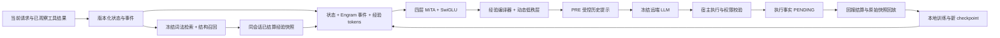

# V0.2.0 Neural Lens 使用与 API 兼容约定

本分支在 V0.1.2 上增量搭建，分支为 `v0.2.0-neural-lens`。原来的插件名、`JitRLLearner` 入口、AstrBot 版本范围、两个事件钩子、`jitrl_recall` 工具、配置键和 Web 路由均保留。`neural.mode` 默认 `off`，旧配置无需修改，也不要求安装 PyTorch；其行为继续由 V0.1 的 `apply_mode`、`learning`、`retrieval`、`policy` 等控制。

新增部分是研究性本地神经控制器，远端 LLM 始终冻结。这里的梯度更新只发生在本地 Neural Lens。论文依据、公式及效果边界见 [研究说明](neural-lens-research.md)。本版本没有真实任务提升的实验结论。

## 1. 从旧版本启用

1. 在 AstrBot 使用的同一 Python 环境中安装可选依赖。仅使用 CPU 时：

   ```bash
   python -m pip install -r requirements-neural.txt --index-url https://download.pytorch.org/whl/cpu
   ```

2. 配置 `neural.mode: shadow`，其余旧配置保留。重载插件后，新决策的历史快照、已观察的执行事实及有来源的回报写入独立神经库；原始 LLM 请求保持不变。shadow 不会附加 V0.1 偏好块，也不会调用旧 reranker。评估器仍遵循现有 `learning.evaluator_mode`，因此 `auto/llm` 可能产生评估调用；选择 `heuristic` 可不使用远端评估器。
3. 使用 `/jitrl lens status` 查看当前会话的采集量。达到默认 32 条已结算样本后，管理员执行 `/jitrl lens train`。可选 `neural.auto_train: true` 开启按事实数触发的后台训练，默认关闭。
4. 改为 `neural.mode: active` 并重载插件。新请求在已训练、版本匹配、证据支持和残差代理门控通过时，使用受限历史提示。门控不通过则保持基础请求。旧配置 `apply_mode: off` 仍禁止注入。

配置示例（对应 AstrBot 中的配置对象，不是需要额外创建的文件）：

```json
{
  "neural": {
    "mode": "shadow",
    "attention_backend": "mita",
    "mita_execution": "grouped",
    "mita_landmarks": 8,
    "mita_topk": 16,
    "mita_query_chunk": 64,
    "memory_tokens": 128,
    "pre_enabled": true,
    "post_enabled": false,
    "auto_train": false,
    "min_samples": 32,
    "train_steps": 20,
    "batch_size": 16,
    "learning_rate": 0.0003,
    "min_support": 3,
    "max_uncertainty": 0.5,
    "relevance_threshold": 0.6,
    "evidence_tokens": 128
  }
}
```

切回 `neural.mode: off` 并重载，即恢复 V0.1 路径。缺少 PyTorch、空库、未训练模型、损坏或不匹配的 checkpoint 都不会阻断合法基础请求；训练命令报告未发布原因。插件不会自动安装依赖或下载模型权重。

`neural.device` 可设 `cpu`（默认）、`cuda` 或 `auto`。显式 `cuda` 在无可用 GPU 时会报告错误，不偷偷更换设备；`auto` 按可用设备选择。训练与推理都使用选择的设备，权重可在 CPU/CUDA 间加载，设备不改变 checkpoint 架构身份。设置修改后重载插件；模型初始化不重设宿主 CUDA 随机数，插件不修改宿主全局线程数。

## 2. 已实现的模型和数据链路



默认本地骨架为 384 hidden、四层 MiTA attention + RMSNorm/SwiGLU、128 维经验概况和 8 个 rank-8 动态基底。状态、最多 32 个事件和最多 128 条经验组成 token 序列；MiTA 逐层以 8 个 landmarks 压缩全体有效 KV、构造每组至多 16 个原始 KV 的可复用 experts，并让每个 query 路由到一个 expert，与全部共享压缩 KV 做一次联合 softmax。6Q/2KV 投影是分组 KV 扩展，默认不再保留旧的单 query GQA 层。完整公式与实现差异见 [MiTA 研究说明](mita-backbone-research.md)。

Engram 继续使用结构事件 suffix 2/3-gram、多头确定性哈希、上下文门控与因果深度卷积。参数表是慢权重，SQLite 经验是事实，fast coefficients 是每次请求重新计算的临时条件值，三者分开；低秩 adapter 与真正的 MiTA 注意力是不同模块。

检索基线使用冻结的带符号字符 N-gram 特征和结构重合度，在最近至多 2048 条有效经验中作有界精确扫描，合并最多 128 条粗选；神经主干保留至多 `memory_tokens` 条，默认 128，证据渲染仍最多两条且有独立文本预算。`legacy` 仍保留原 32 条上限。这里没有部署语义 embedding 服务或 ANN 索引。默认 MiTA 模型约 735 万参数（其中 Engram 表约 26 万），SQLite 与 checkpoint 文件占用独立存在。

后端选项：`mita` 为默认四层 MiTA；`hybrid` 为前三层 MiTA、末层完整 GQA；`gqa` 为同样 token、深度和投影参数的四层完整 GQA；`legacy` 保留开发早期的单 query GQA + 四个向量 MLP。只有前三者是可直接比较的等深 token 主干，不能把相对 legacy 增加容量的变化写成 MiTA 提速。

MiTA 执行层另由 `mita_execution` 控制：默认 `grouped` 将同一专家的 queries 排序打包，KV 在 expert/block 层复用，通过局部融合 SDPA 共同归一化共享和路由分支，然后还原 query 顺序；`reference` 保留逐 query gather 路径。两种执行使用相同权重与支持集，切换无需重训。`mita_query_chunk` 是块上限；分组路径在短序列采用不超过 32 个 query 的块减少空槽，长 CUDA 序列采用静态分配上界避免主机读取动态块数，均未回退全量 GQA。

生产前向关闭路由诊断张量的额外构造；调试接口 `inspect_routing()` 仍返回诊断。FP16/BF16 landmark pooling 使用 FP32 累加后转换回输入精度，避免半精度原子累加抖动改变硬路由。完整性能分析见 [MiTA 算量与算子研究](mita-performance-analysis.md)。

本地训练使用已执行动作的条件回报 Huber loss、实际 PRE 的条件回报 loss、结构动作匹配相关性代理、已观察残差的不确定性代理和正则项。未执行候选没有 return 标签。shadow 的 PRE 只有 NO_OP 数据，active 的首次证据选择依靠受限的相关性规则；它不意味着已经学会某个干预的因果增益。

## 3. 宿主 API 与 POST 接口

现有接口的名字、参数与旧返回字段保持；Web overview 只新增 `neural` 对象。所有自动注入仍走 `req.extra_user_content_parts` 和 `TextPart.mark_as_temp()`，不修改 `req.system_prompt`，不写持久会话，也不调整工具权限集合。TextPart 不可用时，审计记录实际的 NO_OP。

该接入按 AstrBot v4.29.0 的 [ProviderRequest / ToolCallsResult 定义](https://github.com/AstrBotDevs/AstrBot/blob/v4.29.0/astrbot/core/provider/entities.py) 和 [Message / ContentPart 定义](https://github.com/AstrBotDevs/AstrBot/blob/v4.29.0/astrbot/core/agent/message.py) 核对：同时读取 `contexts` 与单个或列表形式的 `tool_calls_result`，支持字典及对象消息，对重复 tool call ID 去重；读取可见的 `req.model` 参与环境隔离，不虚构不可见的 provider 默认模型版本。既有 Python/AstrBot 版本范围不变。

PRE 和 POST 是两个位置。AstrBot 当前接入了 PRE 与完成后采集；本版本没有接管远端候选生成、解码或工具执行。`neural.post_enabled` 仅控制独立库接口，面板会显示 `astrbot_post_connected: false`。

库接口示意：

```python
from jitrl.neural.config import LensConfig
from jitrl.neural.contracts import CandidateSpec
from jitrl.neural.encoding import canonicalize
from jitrl.neural.runtime import LensRuntime

runtime = LensRuntime(data_directory, LensConfig(mode="active", post_enabled=True))
state = canonicalize(
    scope=private_scope, goal=goal, observation=observation,
    allowed_actions=("search", "reply"),
)
decision, epoch = await runtime.prepare(state)
# Adapter attaches decision.rendered as temporary user content, or replaces
# decision with an actual NO_OP when attachment is unavailable.
if await runtime.commit(decision, epoch):
    scores = await runtime.score_candidates(decision, [
        CandidateSpec("a", "tool:search", "search", 0.0, "RANK_ONLY"),
        CandidateSpec("b", "reply", "reply", -0.1, "RANK_ONLY"),
    ])
await runtime.close()
```

`prepare` 返回不可变决策与存储 epoch；`commit` 记录实际送出的 PRE；`score_candidates` 返回与输入顺序一一对应的 `CandidateScore`，不会执行动作或创造新候选。`score` 为 `base_score + adjustment`，有支持且满足门控时调整幅度不超过 `max_adjustment`。`NONE` 来源保留基础选择，低支持、故障和重置后的旧决策弃权。支持的评分来源为 `TOKEN_LOGPROB / VERBALIZED / RANK_ONLY / NONE`；后三者不是真实模型 logits。调用方必须在执行前再校验参数 schema、权限、确认状态和环境前置条件，名称在允许集合中不代表参数已获授权。

POST 使用 PRE 固定的快照与 checkpoint，不会静默切换到刚训练的新权重。该候选评分接口是本项目新增 API，不改动 V0.1 的 `estimate_values`、`select_action`、`MemoryBank` 或 reranker 调用约定。

## 4. 采集、结算、删除与恢复

运行时目录：`<AstrBot 插件数据目录>/astrbot_plugin_jitrl/neural/`。

| 对象 | 保存位置与语义 |
|---|---|
| V0.1 经验与检查点 | 原 `memory.sqlite3` 与原检查点目录，结构不变 |
| 神经决策与事实 | `neural/neural.sqlite3`：独立 decisions、executions、settlements 和 checkpoint 元数据 |
| 模型权重 | `neural/checkpoints/<scope-hash>/lens-*.pt`；原子写入、SHA-256、scope 与版本校验，`weights_only=True` 加载 |
| 原始输入 | 不保存完整网页、工具输出或密钥；只保存经过现有脱敏的有界目标/观测及结构事件 |

一个会话的模型不使用其他会话私有经验。神经路径忽略 V0.1 的 global/hybrid 检索设置，不自动导入原数据库。状态与记忆同时绑定 environment、normalizer、embedding、hash、renderer 与模型结构版本。

请求时保存当时可见的完整检索快照；完成后从当前轮轨迹中只采集有匹配 tool result 的工具调用和实际最终回复。宿主的完成钩子决定了 PENDING 执行事实的落库时点；当前没有即时执行拦截器，不承诺在远端工具执行瞬间持久化。LLM/heuristic/fused 的回报保留来源及较低可靠性权重，不能当成环境真值。评估器关闭或失败而没有可用标签时，事实保持 PENDING。

settlement 追加历史事件，读取按截止时间可见的最新有效事件。修订可使用显式 `event_id` 保证幂等；重复 ID 的冲突 payload 会被拒绝。训练使用保存的原始快照，不查回放时的新库；同 episode、自身或未来才结算的经验均不可进入输入。训练在模型副本上进行，发布后只影响后续请求。

`/jitrl feedback good|bad` 和原有短句关键词继续使用：按上一轮实际 gamma 追加回报事件，保留旧事件和原决策快照。整体用户评价按 V0.1 的回填规则折算为各步增量，并裁剪到评分范围；这是经验性的信用分配，不等同于用户逐步标注的环境真值。没有既有已结算标签的 PENDING 轨迹不会被补成零回报样本。重置、过期或已经消费的反馈均不会重复结算。

神经管理指令：

- `/jitrl lens status`：当前会话状态、依赖、事实数与模型 ID。
- `/jitrl lens train`：管理员训练当前会话的本地模型。
- `/jitrl lens reset confirm`：管理员删除当前会话神经事实、快照和全部已登记权重，并使旧后台写入失效。

从早期向量主干切换时无需清空神经库或重建历史快照。默认 MiTA 检测到旧主干权重时拒绝误加载，`/jitrl lens train` 会用既有因果快照训练新的 MiTA 权重，保留旧 checkpoint。若要继续旧模型，显式设 `neural.attention_backend: legacy`；只有旧参数布局匹配时才可加载。切换 MiTA/hybrid/GQA 的 checkpoint 也需要严格匹配，不使用 `strict=False` 静默补权重。

**旧 `forget`、`checkpoint`、`rollback`、`export` 与对应面板操作只管理 V0.1 经验库。** 它们不会被改成隐式删除新模型；也不构成神经模型的备份或恢复。要删除神经知识，请显式执行 `lens reset confirm`。旧检查点可继续在 V0.1 数据上使用。本版本尚无神经 checkpoint 回滚 UI、神经库导入导出和自动磁盘轮换；长期运行需管理数据目录容量。reset 是逻辑删除，不承诺数据库空闲页、备份介质或已发送远端提示的物理擦除。

## 5. 验证与复现

开发仓库中（scripts 不随插件安装 ZIP 发布）：

```bash
python -m pytest -q
python -m ruff check .
python -m ruff format --check .
node --test tests/test_dashboard.cjs
python scripts/neural_lens.py smoke --steps 20 --json benchmarks/neural-smoke.json
python scripts/neural_lens.py smoke --steps 20 --device cuda --json benchmarks/neural-smoke-cuda.json
python scripts/bench_mita.py --model --json benchmarks/mita-attention.json
python scripts/ablate_mita.py --json benchmarks/mita-memory-ablation.json
python scripts/build_release.py
```

Windows 上若 pytest 的系统临时目录不可用，先创建 `.tmp-pytest`，再使用 `--basetemp=.tmp-pytest/run`。未安装 PyTorch 的环境会跳过张量/训练测试，其余核心与存储/钩子检查继续运行；真实 AstrBot 集成测试需要实际安装宿主。

smoke 默认使用正式 384d/4-block MiTA 模型、一次性 SQLite 与明确标为 synthetic 的回报，验证采集→历史快照→真实梯度更新→保存/重载→未来时点候选评分；`--backend legacy|gqa|hybrid` 可选择对照。不会发起 LLM 调用或修改真实插件数据。演示使用宽松门控覆盖路径，不能作为部署阈值建议或真实成功率证据。`benchmarks/neural-smoke.json` 只记录合成验证结果。

离线训练真实采集数据时必须停止对同一数据目录的宿主写入，显式指定神经目录和 scope：

```bash
python scripts/neural_lens.py status --data-dir <path-to-neural-directory> --scope <private-scope>
python scripts/neural_lens.py train --data-dir <path-to-neural-directory> --scope <private-scope> --steps 20
```

离线命令可追加 `--backend mita|hybrid|gqa|legacy`、`--mita-execution grouped|reference` 与 `--device cpu|cuda|auto`；CPU/CUDA 测试报告是独立的运行记录。

禁止把几个私有 scope 合并成一次训练。比较 V0.1、shadow 与 active 的真实效果时，按时间/任务分割、固定 provider 与评估协议，并记录决策时确实已发布的模型版本；建议消融见研究说明。
